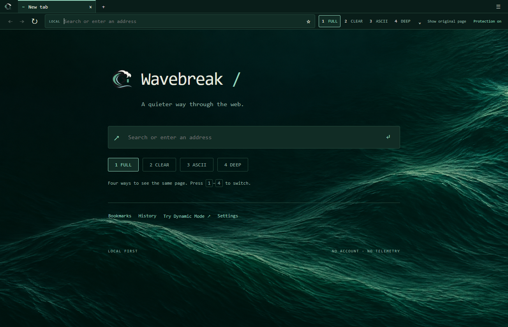
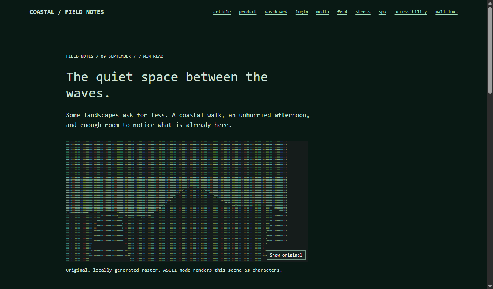
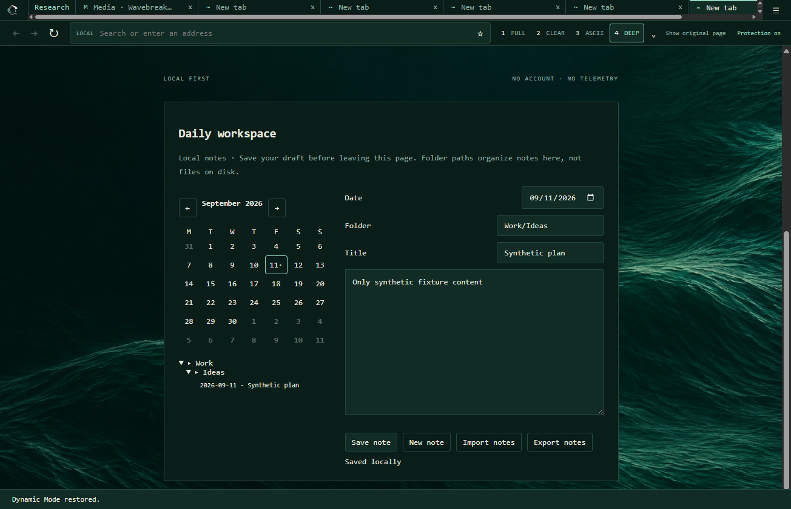

# Wavebreak

**A quieter way to browse, think and work.**

Wavebreak is a desktop browser and local workspace being developed in public. It is beta software, not finished production software. Functionality, performance and integrated workspace features will evolve across beta releases.

## Public Beta

The current published release is **0.2.0-beta.1**, the first beta and the first macOS build. See the [changelog](CHANGELOG.md) and the [release notes](https://github.com/rimedag/wavebreak/releases/tag/0.2.0-beta.1) for what shipped and its known issues.

The macOS app is signed with Developer ID and notarized by Apple. The Windows x64 build is not code-signed, so Windows may show a SmartScreen warning. The source code is proprietary and is not published in this repository.

## What ships today

- Secure Electron browsing shell with isolated website views and local browser chrome.
- Native macOS menu and shortcuts; per-site permission prompts for camera, microphone, location, notifications and clipboard reading; guarded sign-in popups.
- Tabs, tab groups, bookmarks, history, downloads, find, zoom, mute, print and fullscreen basics.
- Memory Saver with **Off**, **Balanced**, **Aggressive** and **Manual** modes. Balanced is the default; manual Sleep controls appear only in Manual.
- Denser tabs, an anchored overflow dropdown and configurable site markers: None (default), Initial or Site icon.
- Background-tab mute without switching tabs, plus an independent all-window master mute.
- Four Dynamic Modes:
  - **1 FULL**: regular page rendering with protection enabled.
  - **2 CLEAR**: lighter distraction filtering.
  - **3 ASCII**: terminal-inspired presentation with local ASCII conversion for eligible images and preserved primary video layout.
  - **4 DEEP**: stronger focus mode with secondary media/recommendations masked and simplified controls for supported media.
- Fast reversible mode switching for supported pages.
- Per-tab, site, session and global mode scope.
- Darker Private windows using isolated nonpersistent browsing partitions, plus a persistent Normal/Private default for new windows.
- Protection based on Ghostery/adblocker lists, with honest limits.
- 24 dark color palettes with phthalo green as the default.
- Optional Stillpoint and Daily workspace with independently selected Markdown folders and a real folder tree.
- One detachable Stillpoint editor: its anchor tab can Summon it back, and closing the floating window reattaches the same live editor.

Balanced and Aggressive Memory Saver let eligible inactive tabs sleep automatically and restore them when selected. Scroll position is restored approximately. Active tabs, audible/media tabs, active-download tabs, internal/non-HTTP(S) views and tabs with detected editable user input are protected from automatic sleep. Manual disables automatic sleeping and exposes Sleep controls on eligible inactive tabs; Off disables both.

Internal validation example: in one 10-tab same-session validation, Balanced Memory Saver reduced total Wavebreak process-tree RAM from ~3.2 GB to ~1.5 GB by sleeping eligible inactive tabs. Results vary with websites and session state.

## See Wavebreak in action

Short silent screen recordings from the public alpha line running on real pages. Current videos were recorded with `0.1.0-alpha.6`; current tab controls and workspace behavior have since evolved. ASCII and DEEP still transform the live page; this release does not claim reduced renderer memory from those modes.

### Dynamic Modes

Switching FULL, CLEAR, ASCII and DEEP on a long Wikipedia article, with no reload between modes.

https://github.com/user-attachments/assets/1bb9f606-0c96-4bf3-a3ad-b05cd0911e5a

### Dynamic Modes on a richer page

The same four modes on an image-heavy NASA Science page. ASCII converts eligible images and keeps their alt text; DEEP simplifies the layout and masks secondary media. CLEAR is deliberately subtle on pages that are already clean.

https://github.com/user-attachments/assets/01a65f66-df47-4fe6-9388-d0336e9c8f72

## Stillpoint

Stillpoint is Wavebreak's optional local thinking and note-taking environment. Alpha.8 adds a file tree, a separate Daily Markdown folder and one detachable editor. Detaching leaves an anchor tab with **Summon Stillpoint**; summon or the floating window's close button returns the same editor and live workspace. Unsafe unsaved drafts prevent detaching. A separate standalone product and richer workflows remain future work.

Read more about [Stillpoint](docs/stillpoint.md) and what exists today.

### Daily workspace

Opening Daily in a new tab, writing a short note and saving it locally, then returning to browsing.

https://github.com/user-attachments/assets/3b5d21b0-bd41-4bf1-a425-ad99ef756bbe

## Privacy

Wavebreak currently has no product account, no cloud sync and no in-app product analytics. Browsing still contacts the websites, search engines, media providers and filter-list providers you choose to use. Private sessions isolate local browsing state, but they do not make you anonymous to websites, networks or your internet provider.

Read the [privacy notice](PRIVACY.md).

## Downloads

**[Download Wavebreak 0.2.0-beta.1](https://github.com/rimedag/wavebreak/releases/tag/0.2.0-beta.1)**

macOS 12 or later (Apple Silicon and Intel), signed and notarized:

- [DMG](https://github.com/rimedag/wavebreak/releases/download/0.2.0-beta.1/Wavebreak-0.2.0-beta.1-mac-universal.dmg) — open and drag Wavebreak to Applications (226 MiB)
- [ZIP](https://github.com/rimedag/wavebreak/releases/download/0.2.0-beta.1/Wavebreak-0.2.0-beta.1-mac-universal.zip) — the same app as a ZIP (226 MiB)

Windows 10/11 x64, not code-signed:

- [Setup](https://github.com/rimedag/wavebreak/releases/download/0.2.0-beta.1/Wavebreak-Setup-0.2.0-beta.1-x64.exe) — installer (111 MiB)
- [ZIP](https://github.com/rimedag/wavebreak/releases/download/0.2.0-beta.1/Wavebreak-0.2.0-beta.1-win-x64.zip) — unzip and run `wavebreak.exe` (153 MiB)

Verify your download against `SHA256SUMS.txt`, attached to the same release. Windows may show "Windows protected your PC" on first run (More info → Run anyway). Do not disable OS security protections in response to a warning.

Windows users upgrading from an alpha: close all Wavebreak processes and copy `%APPDATA%\Wavebreak` somewhere safe first. The beta turns on cookie encryption, which an older alpha cannot read back. The beta.1 Windows build has not yet been confirmed on Windows; keep alpha.8 if you depend on it. Markdown files stay in their chosen folders. Read the release notes before upgrading.

Earlier alphas and later builds are on [GitHub Releases](https://github.com/rimedag/wavebreak/releases). Only download Wavebreak from an official release. The repository ZIP is documentation, not the application.

## Platforms

| Platform | Status |
| --- | --- |
| macOS 12+ (Apple Silicon and Intel) | Public beta available, notarized. |
| Windows x64 | Public beta available, not code-signed. |
| Linux | Planned; no public build yet. |
| Android | Planned; future mobile build. |
| iPadOS / iOS | Planned; future mobile build. |

## Roadmap

Wavebreak's roadmap is organized by themes, not promised dates. See [ROADMAP.md](ROADMAP.md).

## Feedback

Use Issues for reproducible bugs and feature requests. Use Discussions for ideas, questions and beta feedback.

Do not post passwords, cookies, browsing history, private notes, private URLs or vulnerability details publicly. Report security issues through the private channel described in [SECURITY.md](SECURITY.md).

## Proprietary Notice

Wavebreak is free proprietary software. You may download and use official released application builds under the included terms. The source code is private and no open-source license is granted.

See [LICENSE.md](LICENSE.md) and [EULA.md](EULA.md).
